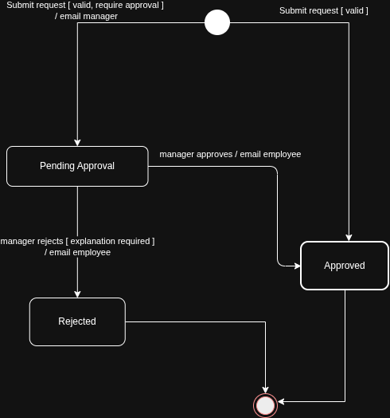
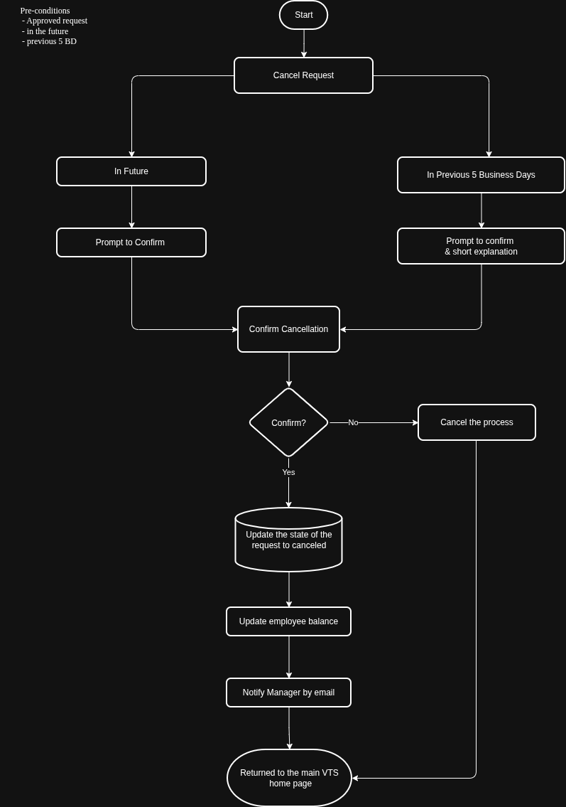
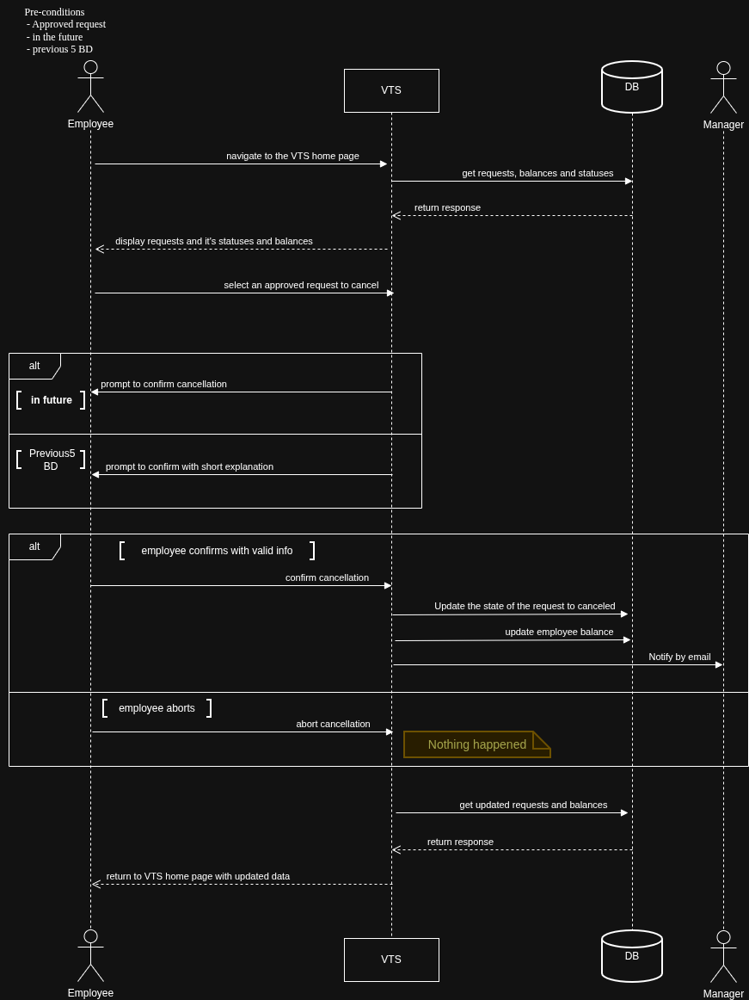
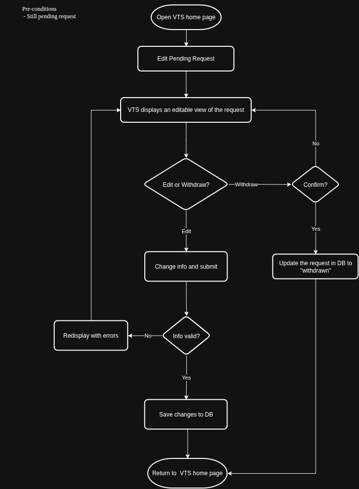
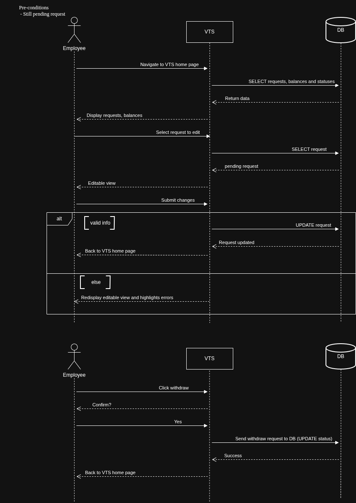
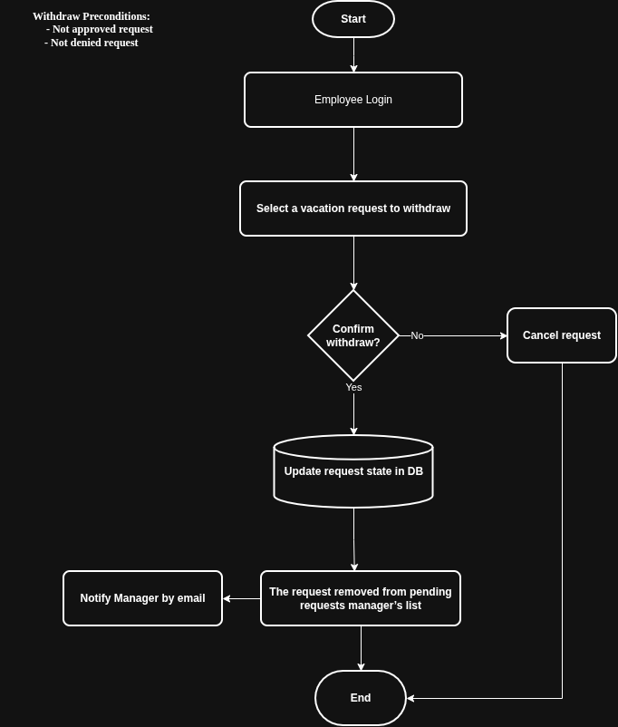
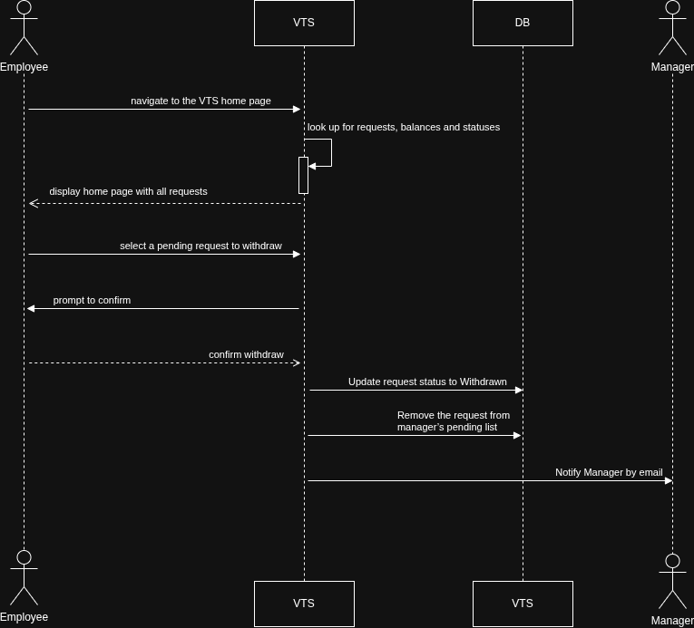
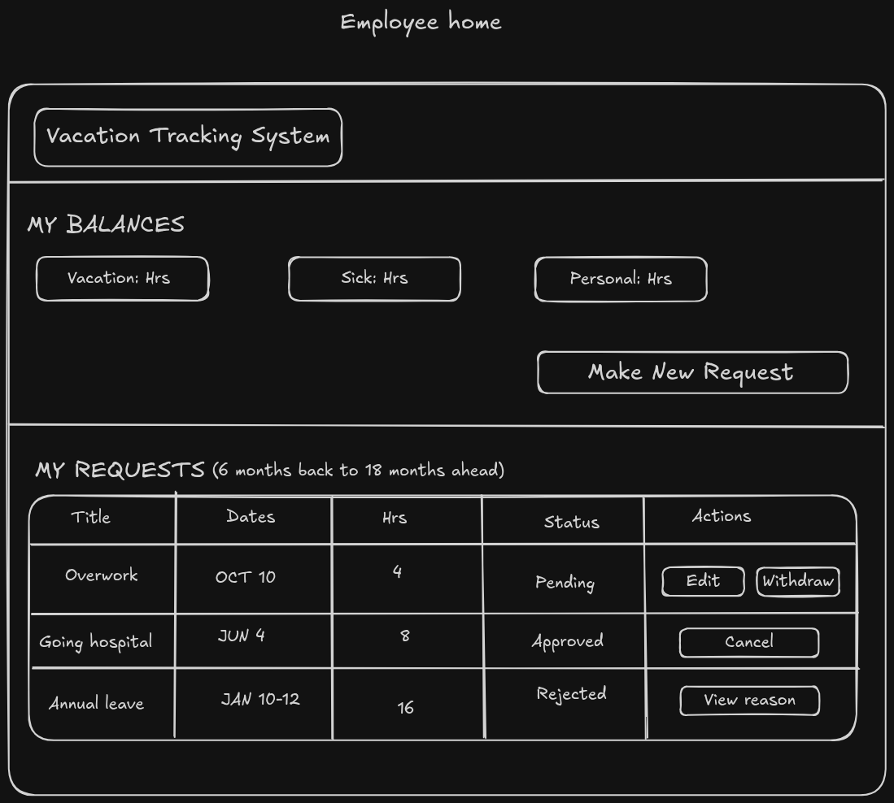
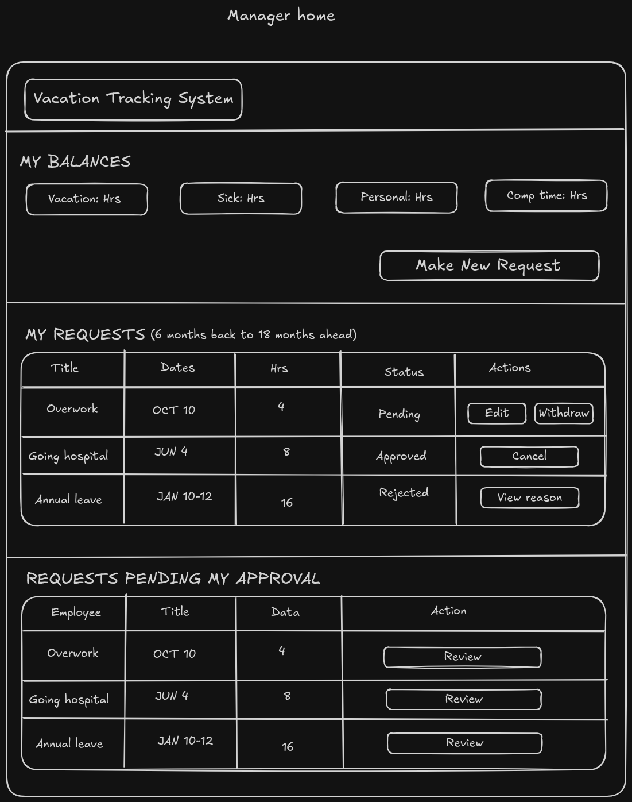
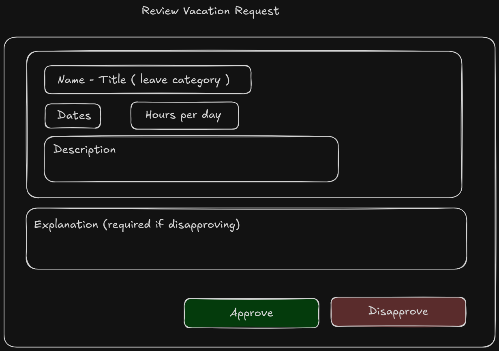

# Vacation Tracking System

This README consolidates all documentation for the VTS project — the project vision and requirements, the design artifacts for each task, and the UI mockups — into a single document for easy review.

---

## Table of Contents

1. [Vision](#vision)
2. [Domain Overview](#domain-overview)
3. [Actors](#actors)
4. [Functional Requirements](#functional-requirements)
5. [Non-Functional Requirements](#non-functional-requirements)
6. [Constraints](#constraints)
7. [Assumptions](#assumptions)
8. [Task 1 — Manage Time Use Case](#task-1--manage-time-use-case)
9. [Task 2 — Extended Use Case Designs](#task-2--extended-use-case-designs)
10. [UI Mockups](#ui-mockups)
11. [Repository Structure](#repository-structure)

---

## Vision:

- **The Problem:**

  Workers often divide their time across multiple projects and report to multiple project managers. As a result, managers have fewer informal interactions with their workers and find it harder to track and manage their vacation time.

- **Business Objectives:**
  - Streamline HR department functions.
  - Minimize non-core, administrative activities for management.
  - Empower employees to manage their own leave.
  - Save time and money, and accelerate internal business processes
- **The Solution:** A Vacation Tracking System (VTS) that provides individual employees with the capability to manage their own vacation time without having to be an expert in company or local facility leave policies.

---

## Domain Overview

The system belongs to the Human Resources Management domain, specifically Vacation (Absence) Management: tracking employees' time off, its balances, and the approval process around it, inside a company intranet.

### Problem Definition:

Workers often divide their time across multiple projects and report to multiple project managers. As a result, managers have fewer informal interactions with their workers and find it harder to track and manage their vacation time. And handling vacations times manually is slow and consumes HR and management time.

---

## Actors

- **Employee**: Requests and tracks their own leave.
- **Manager**: Approves or rejects subordinates' requests; may award personal leave within system limits.
- **HR Clerk**: HR department member responsible for keeping employee data accurate and up to date across HR systems. Can view employees' personal data and add, update, or remove vacation records and balances.
- **System Admin**: Technical role responsible for running the system's technical resources (web server, database) and Backup Systems Logs.

---

## Functional Requirements

### Authentication & Authorization

- FR-AUTH-01: The system shall identify users through the portal's Single Sign-On (SSO).
- FR-AUTH-02: The system shall allow employees to manage only their own vacation time.
- FR-AUTH-03: The system shall allow only HR clerks to view employees’ personal data.

### Vacation Request Management

- FR-REQ-01: The system shall be accessible through a link in the intranet portal.
- FR-REQ-02: The system shall display the employee's current requests and outstanding balances.
- FR-REQ-03: The system shall display requests from the previous 6 months up to 18 months ahead.
- FR-REQ-04: The system shall allow the employee to select a leave category with a positive balance.
- FR-REQ-05: The system shall provide a visual calendar to select and compare dates.
- FR-REQ-06: The system shall allow the employee to select dates and hours per date (e.g. 4 hours = half day).
- FR-REQ-07: The system shall require a short title and a description (max one paragraph).
- FR-REQ-08: The system shall validate each request against the configured leave rules on submission.
- FR-REQ-09: The system shall highlight and document errors when validation fails, and allow the employee to correct or cancel the request.
- FR-REQ-10: The system shall return the employee to the VTS home page when the request passes validation.
- FR-REQ-11: The system shall set a valid request to "Pending Approval" if manager approval is required, otherwise to "Approved".

### Approval Workflow

- FR-APR-01: The system shall email the authorized manager(s) immediately when a request enters "Pending Approval".
- FR-APR-02: The system shall allow the manager to respond through a link in the email or by navigating to the VTS home page in the portal.
- FR-APR-03: The system shall list the manager's own requests and balances on the home page.
- FR-APR-04: The system shall list requests pending approval by subordinates in a separate section.
- FR-APR-05: The system shall display the details of each request and let the manager approve or reject it individually.
- FR-APR-06: The system shall require the manager to enter an explanation when rejecting a request.
- FR-APR-07: The system shall update the request state to "Approved" or "Rejected" when the manager submits the decision, then return the manager to the home page.

### Balance Management

- FR-BAL-01: The system shall allow HR Clerk to enter employee vacation data (e.g., annual, sick, or personal leave balance).
- FR-BAL-02: The system shall allow HR Clerk to update employee vacation balances.
- FR-BAL-03: The system shall allow managers to directly award personal leave time within system-set limits.

### Notifications

- FR-NOT-01: The system shall email the employee whenever the status of their request changes (approved or rejected).

### Audit Log & Overrides

- FR-AUD-01: The system shall log all transactions (who, what, when, old/new value).
- FR-AUD-02: The system shall allow HR and System Admin to override actions restricted by rules.
- FR-AUD-03: The system shall log every override.

---

## Non-Functional Requirements

- NFR-01: The system shall be easy to use (measurable target, e.g. an employee can submit a request in under 2 minutes).
- NFR-02: The rules engine shall be flexible: leave rules shall be configurable without code changes.
- NFR-03: The system shall be auditable through the activity log (e.g. entries cannot be modified).
- NFR-04: Performance, availability, concurrent users, supported browsers, accessibility, and security targets shall be defined.

---

## Constraints

- The system must use existing hardware and middleware.
- The system must be implemented as an extension of the existing intranet portal.
- The system must rely on the portal's SSO for all authentication and must not implement its own authentication mechanism.

---

## Assumptions

ASM-01: An HR clerk who is also an employee has two separate login IDs, one per role. The VTS treats each ID as a different user with its own permissions. (The Portal is responsible for this, while the VTS simply treats each ID as a distinct user.)

---

## Task 1 — Manage Time Use Case

This task covers the design artifacts for the **Manage Time** use case of the Vacation Tracking System, including the entity-relationship model, the end-to-end workflow flowchart, and the system sequence diagram.

> The pseudocode for this use case lives in [Task1/manageTime_useCase/pseudocode.md](Task1/manageTime_useCase/pseudocode.md).

### Entity Relationship Diagram (ERD)

The ERD below models the data structure of the Manage Time use case. It shows the core entities — Employee, VacationRequest, VacationRequestDay, VacationCategory, VacationBalance, ApprovalDecision, and Calendar — along with their attributes and the relationships between them (e.g., an Employee _submits_ VacationRequests, a Manager _decides_ on them via ApprovalDecision, and each request _contains_ one or more VacationRequestDays).


### Flowchart

#### Simplified Flowcharts

The following two diagrams are simplified, role-specific views of the main flowchart below, isolating each actor's perspective for easier readability.

##### Employee Flow

The Employee Flow focuses on the employee's journey: selecting VTS from the portal, viewing vacation balances, choosing a vacation type and filling the form, submitting the request, handling validation errors, and — if approval is required — notifying the manager by email before saving the request to the database.


##### Manager Flow

The Manager Flow focuses on the manager's journey: receiving the leave-request email notification, logging in, deciding to approve or reject (with an explanation on rejection), saving the decision and status to the database, and notifying the employee by email.


#### Complete Flowchart

The flowchart below illustrates the complete workflow of the Manage Time use case across three swimlanes — Employee, VTS, and Manager. It covers the employee selecting a vacation type with a positive balance, entering and submitting request details, the system validating the data (with errors highlighted for correction or cancellation), and the manager reviewing, approving, or rejecting the request, including email notifications and post-decision navigation.


### Sequence Diagram

The sequence diagram below details the message flow over time between the Employee, Manager, Intranet Portal, VTS, and Email Notification components. It shows the employee opening VTS via the intranet portal, submitting a vacation request, the alternative paths for data validation (valid vs. invalid/incomplete data), whether manager approval is required, the manager's credential check, the approve/disapprove decision, and the resulting email notification to the employee.


---

## Task 2 — Extended Use Case Designs

This task extends the Manage Time design with the vacation-request lifecycle, the Cancel / Edit / Withdraw use cases, and UI mockups.

### State Diagram of Vacation Request

State machine showing all possible states and transitions of a vacation request throughout its lifecycle.



### Cancel Request

Flowchart showing the steps and decisions involved in cancelling a vacation request.



Sequence diagram showing the interactions between actors and the system during cancellation.



### Edit Request

Flowchart showing the steps and decisions involved in editing a vacation request.



Sequence diagram showing the interactions between actors and the system during editing.



### Withdraw Request

Flowchart showing the steps and decisions involved in withdrawing a vacation request.



Sequence diagram showing the interactions between actors and the system during withdrawal.



---

## UI Mockups

Employee home page showing leave balances, a button to create a new request, and a list of past requests with status-based actions.



Manager home page extending the employee view with an additional section listing requests pending the manager's approval.



Review vacation request screen where a manager can view request details and either approve or disapprove with an explanation.



---

## Repository Structure

```
Vacation_Tracking_System/
├── README.md                                  ← This document (consolidated project documentation)
├── Task1/
│   ├── README.md
│   └── manageTime_useCase/
│       ├── README.md
│       ├── pseudocode.md
│       └── diagrams/
│           ├── ERD_VTS_ManageTime_usecase.png
│           ├── Flowchart_VTS_ManageTime_useCase.png
│           ├── manageTime_useCase_EmployeeFlow.drawio.png
│           ├── manageTime_useCase_ManagerFlow.drawio.png
│           └── sequenceDiagram_VTS_timeManagement_usecase.png
└── Task2/
    ├── cancel_edit_withdraw_usecases/
    │   ├── README.md
    │   └── diagrams/
    │       ├── CancelRequest_Flowchart.drawio.png
    │       ├── CancelRequest_SequenceDiagram.drawio.png
    │       ├── EditRequest_Flowchart.drawio.png
    │       ├── EditRequest_SequenceDiagram.drawio.png
    │       ├── WithdrawRequest_Flowchart.drawio.png
    │       └── WithdrawRequest_SequenceDiagram.drawio.png
    ├── stateDiagramOfVacationRequest/
    │   ├── README.md
    │   └── StateMachine_VacationRequest.drawio.png
    └── VTS-UI/
        ├── README.md
        └── images/
            ├── employee_home_UI.png
            ├── manager_home_UI.png
            └── review_vacation_request.png
```

The original per-folder READMEs are kept alongside their artifacts and remain viewable in each task folder:

- [Task1/README.md](Task1/README.md)
- [Task1/manageTime_useCase/README.md](Task1/manageTime_useCase/README.md)
- [Task2/cancel_edit_withdraw_usecases/README.md](Task2/cancel_edit_withdraw_usecases/README.md)
- [Task2/stateDiagramOfVacationRequest/README.md](Task2/stateDiagramOfVacationRequest/README.md)
- [Task2/VTS-UI/README.md](Task2/VTS-UI/README.md)
