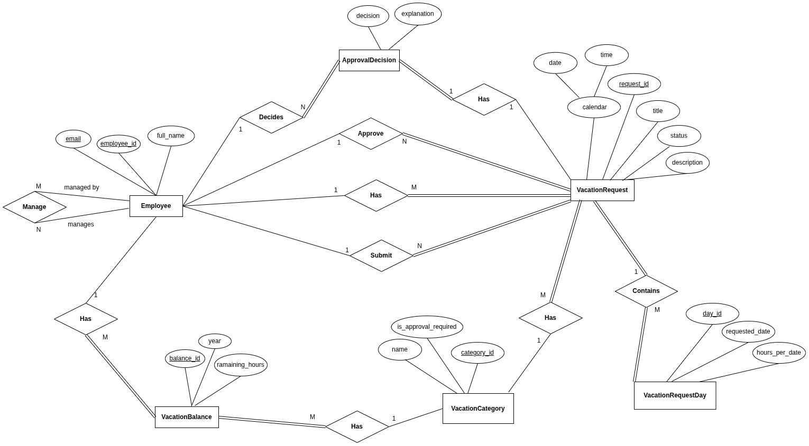
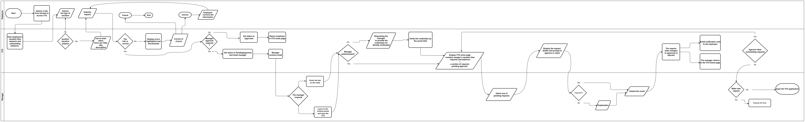

# Manage Time Use Case — Vacation Tracking System (VTS)

This folder contains the design artifacts for the **Manage Time** use case of the Vacation Tracking System, including the entity-relationship model, the end-to-end workflow flowchart, and the system sequence diagram.

---

## Entity Relationship Diagram (ERD)

The ERD below models the data structure of the Manage Time use case. It shows the core entities — Employee, VacationRequest, VacationRequestDay, VacationCategory, VacationBalance, ApprovalDecision, and Calendar — along with their attributes and the relationships between them (e.g., an Employee *submits* VacationRequests, a Manager *decides* on them via ApprovalDecision, and each request *contains* one or more VacationRequestDays).

---

## Flowchart

The flowchart below illustrates the complete workflow of the Manage Time use case across three swimlanes — Employee, VTS, and Manager. It covers the employee selecting a vacation type with a positive balance, entering and submitting request details, the system validating the data (with errors highlighted for correction or cancellation), and the manager reviewing, approving, or rejecting the request, including email notifications and post-decision navigation.

---

## Sequence Diagram

The sequence diagram below details the message flow over time between the Employee, Manager, Intranet Portal, VTS, and Email Notification components. It shows the employee opening VTS via the intranet portal, submitting a vacation request, the alternative paths for data validation (valid vs. invalid/incomplete data), whether manager approval is required, the manager's credential check, the approve/disapprove decision, and the resulting email notification to the employee.

